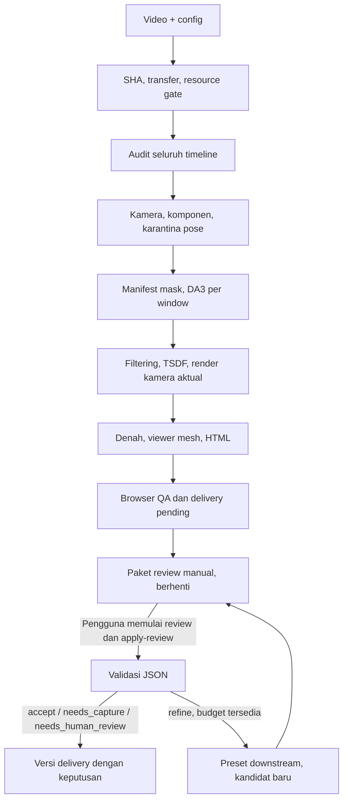

# Workflow: video → mesh, denah 2D, HTML → review manual

**16 Oktober 2026.** Orchestrator diuji dengan numerik fresh dari video sampai output. Sesuai keputusan pengguna, **review tetap manual** untuk mengendalikan usage limit. Script tidak memanggil Codex, LLM, subagent atau layanan review eksternal. Otomatisasi berhenti setelah output dan bukti QA tersedia.

[PRD](docs/PRD.md): kebutuhan. [ROADMAP](docs/ROADMAP.md): milestone. [PROGRESS](docs/PROGRESS.md): hasil aktual. PART1 di `end_product/part1/` tetap immutable; job baru masuk `outputs/jobs/<job>/` dan hasil final `end_product/<job>/vNNN/`.

[TECHSTACK](docs/TECHSTACK.md) menjelaskan teknologi/runtime aktual; [ARCHICON](docs/ARCHICON.md) adalah panduan dashboard. Rekaman baru dilaporkan selesai, overall OK; review formal tetap pending. Eksperimen lama dipisahkan tanpa penghapusan; lihat [arsip dan restore](docs/OUTPUTS_ARCHIVE.md). Snapshot eksperimen/resource lama bukan status live job tersebut.

HTML yang dibangun berikutnya memakai desain room tour ArchiCon untuk arsitektur/interior, dengan font/aset embedded. Kontrol komponen, 3D, denah dan kalibrasi: [ROOM_TOUR](docs/ROOM_TOUR.md). Job `lantai3_part1_1016_1525/v002` merupakan pembaruan UI dari bundle yang sama, tanpa rekonstruksi ulang; v001 tetap tersedia dan review formal tetap pending.

## 1. Status aktual

| Bagian | Implementasi dan bukti |
|---|---|
| Registrasi | SHA, metadata, durasi dan kapasitas sampling dari video input; tanpa konstanta capture lama |
| Worker | Detached server process, lock job/GPU, status/log persisten, fingerprint dan checksum |
| Numerik | Adapter audit → kamera → DA3 → filtering/TSDF → render → denah/viewer |
| Kamera | World terpisah dipertahankan; frame pose ekstrem dikarantina tanpa membuang seluruh komponen |
| Delivery | Mesh detail GLB, SVG/PNG, HTML offline, coverage, kegagalan komponen, manifest SHA |
| Browser QA | Offline, semua pilihan komponen, denah dan mobile diuji pada paket cache |
| Kalibrasi | Simpan/muat JSON; terikat component ID dan SHA viewer mesh; skala world independen |
| Review | Input, prompt dan schema JSON manual; kualitas unassessed sampai keputusan diterapkan |
| Refinement | Preset S06/S07 dari JSON tervalidasi; maksimal 2 ronde × 2 kandidat; berhenti untuk review manual berikutnya |
| Regresi cache | v002 berhasil dipaketkan/diuji browser; v003 menambahkan review manual `needs_capture` pada produk yang sama |
| Smoke fresh | Klip12detik gagal inisialisasi SfM; klip30detik `part2_smoke_003` berhasil60/60 melalui semua stage dan QA |
| Video penuh fresh | Cold-run full001 selesai:280/302,5world. Auto/exhaustive full002:283/302,19gap,1world; QA lulus, review manual needs_capture |
| Refinement nyata | Dua kandidatS06 smoke diproses dan direview manual; baseline dipertahankan karena belum ada peningkatan material |

Regresi cache dan cold-run video acuan telah diuji. Pengujian pada rekaman independen dan kelengkapan seluruh interior masih belum terbukti.

## 2. Command dan lokasi eksekusi

Dari root proyek pada laptop, dengan runtime/dependency proyek yang sudah tersedia:

```bash
rtk proxy .venv/bin/python scripts/run_pipeline.py run --input raw_videos/rekaman_baru.MOV --job-id rekaman_baru_001 --review-agent manual
rtk proxy .venv/bin/python scripts/run_pipeline.py plan --job-id rekaman_baru_001
rtk proxy .venv/bin/python scripts/run_pipeline.py status --job-id rekaman_baru_001
rtk proxy .venv/bin/python scripts/run_pipeline.py resume --job-id rekaman_baru_001
```

`manual` adalah default dan satu-satunya mode review. `run` membuat job baru; ID yang sudah ada ditolak. `resume` melanjutkan job itu. `--detach` melepas controller setelah worker server dimulai; gunakan `resume` untuk mengambil hasil dan packaging. Putus SSH/laptop tidak menghentikan worker. Lock mencegah dua controller/job yang sama.

Video harus selesai ditulis/disalin sebelum `run`. Jika byte video berubah setelah registrasi, checksum gate menghentikan job; gunakan input final dan ID baru.

Default mesin: `configs/paths.server.yaml`; SSH: `configs/paths.local.yaml`. `--ssh-target user@host` mengganti target. `--local-worker` membutuhkan seluruh runtime/model pada mesin tersebut, bukan jalur normal laptop ini.

Regresi cache video acuan, memakai ID baru bila diulang:

```bash
rtk proxy .venv/bin/python scripts/run_pipeline.py run --input raw_videos/lantai2_B_part3.MOV --job-id cache_check_002 --reuse-config configs/reuse_l2bp3.json
```

Reuse-config tersebut hanya untuk video acuan. Hash dan kontrak upstream tetap diverifikasi.

| Lokasi | Tugas |
|---|---|
| Laptop | Registrasi, SSH/rsync, monitoring, transfer, HTML build, browser QA, review packet dan delivery |
| Server `/srv/archicon` | Audit, COLMAP CPU, DA3 pada GPU terpilih, filtering/TSDF, render dan exporter |
| Sesi review yang dimulai pengguna | Membuka gambar bukti, menilai hasil, menulis JSON review |

Source memakai `.sync-files`. Video disalin ke nama canonical berbasis SHA dan diverifikasi di server. Artefak ditarik berdasarkan manifest dan checksum. Proyek lama/cache model/PART1 tidak ditulis. Tidak ada upload gambar ke layanan review oleh pipeline. Delivery dibuat di laptop; arsip delivery ke server disalin terpisah.

Runtime server: `.venv` untuk audit/PyCOLMAP, `.venv-inference` untuk DA3/PyTorch, `.venv-geometry` untuk Open3D/Trimesh. Laptop memakai Python, Node dan dependency `web/package-lock.json`; browser QA memakai CLI Playwright yang dipin. Model/dependency tidak diupgrade otomatis.

## 3. Alur stage



| Stage | Kontrak utama |
|---|---|
| S00/S01 | Input SHA/config resolved; model/runtime/resource gate sebelum komputasi |
| S02 | Full-timeline keyframe, source PTS, hash RGB, audit dan contact sheet; default base 2fps dengan adaptive 4fps pada interval gerak tinggi, tanpa frame sintetis |
| S03 | Sparse components, K/pose, undistorted RGB; sequential overlap/loop closure dapat dipakai untuk menjembatani lintasan, outlier tetap ditolak/dikarantina |
| S04 | Mask sesuai frame/grid/hash. Kaca/manual kosong tetap unreviewed; tidak memakai polygon capture lama |
| S05 | DA3 conditioned per komponen/window; frame/K/pose konsisten, optical-axis Z, unit map relatif |
| S06 | Confidence/spatial/multi-view/person filtering, TSDF, GLB/PLY valid |
| S06R | Actual-triangle render, SHA mesh/kamera, transform world→viewer sebelum exporter |
| S07 | Irisan, SVG/PNG, lintasan, viewer mesh. Bila lantai gagal, 3D valid dipertahankan dengan peringatan denah |
| S08 | HTML embedded dan browser QA; setiap keyframe processed/gap, world berbeda tidak dipaksa digabung |
| S09 | Menyiapkan input/prompt/schema review; tidak memulai reviewer |
| S10 | Setelah apply-review: preset dan downstream; kandidat menunggu review manual baru |
| S11 | Delivery immutable dengan status execution/review/quality/scale terpisah |

Komponen yang seluruh frame-nya duplikat komponen lebih besar dapat dilewati; overlap sebagian dipertahankan. Coverage menghitung union ID frame. Kegagalan data per komponen dilaporkan, komponen lain yang valid tetap dipaketkan. Error runtime/model/resource tidak disamarkan sebagai kegagalan geometri.

Profil room-tour default memakai adaptive sampling (base 2fps, high-motion 4fps) dan sequential matching overlap32. Loop closure hanya boleh diaktifkan jika `processing.vocab_tree_path` menunjuk ke vocabulary tree lokal; pipeline offline tidak mengunduh asset. `auto` tetap memakai exhaustive untuk≤400keyframe yang benar-benar diaudit (maks79.800pasangan); di atasnya sequential dengan overlap16. Adaptive sampling hanya memilih frame asli dan menaikkan kepadatan di interval gerak tinggi; tidak memperbaiki motion blur. Mode, overlap dan loop closure dapat diubah lewat `processing`; ini bukan jaminan semua video akan tersambung. Klip dinding polos dapat tetap gagal initial pair tanpa variasi geometri/kalibrasi yang cukup.

Jika semua komponen gagal, job failed dengan diagnosis di worker/stage log dan `component-failures.json` bila tersedia. Belum ada delivery mesh/tour atau paket review visual lengkap untuk kondisi tersebut. Tidak membuat geometri dummy.

## 4. Resource, checkpoint dan resume

| Batas | Kebijakan |
|---|---|
| GPU | Hanya satu UUID GPU yang dikonfigurasi pada machine profile; isolasi mengeksposnya sebagai logical `cuda:0` |
| Gate inference | ≥14 GiB VRAM free, idle, tanpa compute process lain |
| Gate host/disk | ≥8 GiB RAM available, ≥50 GiB disk free sebelum stage berat |
| Runtime | Process-tree RSS ≤6 GiB, GPU process ≤14 GiB, allocator PyTorch ≤12 GiB |
| CPU | 4 thread, 2 worker; COLMAP/geometry menyembunyikan CUDA |
| Watchdog | Timeout/resource abort hanya untuk process group milik job |

Resource gate menghasilkan `waiting_resources`, exit code 75. Setelah kapasitas tersedia, gunakan `resume`; batas tidak diturunkan otomatis. Lock proyek bukan reservasi terhadap proses eksternal, sehingga telemetry tetap diperiksa.

Fingerprint mencakup hash file/isi direktori input, parameter, argv, source lokal relevan, compute profile dan identitas runtime yang dicatat. Adapter memeriksa kontrak model/kamera/depth. Reuse memerlukan status sukses, fingerprint cocok dan hash seluruh output cocok. Source yang berubah dapat memicu rerun konservatif.

Attempt gagal tidak dipakai ulang. Input/parameter/output berubah menghasilkan attempt baru. S06 refinement mempertahankan kamera/depth valid; S07 mempertahankan mesh/render. Transaksi review dan kandidat selesai disimpan agar resource wait tidak menerapkan review dua kali. Jika worker mati keras dengan status masih running, operator perlu memeriksa PID/log/lock; deteksi seluruh stale-worker otomatis belum tersedia.

## 5. Review manual dan refinement

Setelah output dan browser QA:

```text
execution_status = completed
review_status = pending
quality_status = unassessed
scale_status = relative
```

CLI mencetak path `review-input.json`. Siapkan snapshot baru bila diperlukan:

```bash
rtk proxy .venv/bin/python scripts/run_pipeline.py prepare-review --job-id rekaman_baru_001
```

Paket memuat job/ronde, fingerprint, komponen, coverage/gaps, kegagalan komponen, gambar aktual serta SHA bukti/bundle/manifest produk. Folder sama berisi `review-prompt.md` dan `review-schema.json`. Reviewer harus membuka source/render, overview dan denah setiap world; statistik saja tidak cukup. Bukti di luar budget ditandai incomplete dan tidak boleh accepted.

Pengguna memulai review saat diperlukan. Setelah JSON disimpan sesuai schema:

```bash
rtk proxy .venv/bin/python scripts/run_pipeline.py apply-review --job-id rekaman_baru_001 --review-file outputs/jobs/rekaman_baru_001/review/manual.json
```

JSON harus merujuk job, ronde, fingerprint, component ID, timestamp dan path bukti yang tepat. Bukti/bundle/produk yang berubah ditolak. Keputusan: `accept`, `refine`, `needs_capture`, `needs_human_review`. Reviewer tidak dapat mengarang meter, menyatakan semua interior lengkap atau menjalankan shell bebas.

| Aksi refinement | Stage | Kandidat |
|---|---|---|
| `compare_filter_candidates` | S06 | Confidence lebih ketat atau surface lebih kasar; kamera/depth tetap |
| `adjust_viewer_mesh` | S07 | Viewer lebih detail atau ringan; mesh sumber tetap |

Satu jenis aksi per ronde; beberapa findings boleh meminta aksi sama. Maksimal 2 ronde × 2 kandidat. Setelah kandidat selesai, pipeline kembali berhenti untuk review manual. Baseline dipertahankan sampai review memilih kandidat. Kedua presetS06 sudah diuji pada smoke nyata; baseline tetap dipilih karena kandidat belum menunjukkan peningkatan material. Ini menguji executor, bukan jaminan preset memperbaiki video lain. Budget habis tidak berarti kualitas lulus.

Pemulihan PnP generik, masks kaca baru, pergantian kamera/model/backend, semantic floorplan dan perubahan source belum menjadi aksi otomatis. Itu pekerjaan pengembangan terpisah. Area tak terekam memerlukan rekaman tambahan.

## 6. Struktur output

```text
outputs/jobs/<job>/
  job.json, job-status.json, worker-status.json
  config/{machine.yaml,capture.json,annotations-*.json,tour-config.json}
  stages/<stage>/<run_id>/                              # attempt immutable
  logs/{worker.log,launch.log,<run_id>.log}
  stages.json, events.jsonl, bundle.json, review-bundle.json
  qa/vNNN/{report.json,overview.png,floorplan.png,mobile.png}
  review/round_00/request_001/
    review-input.json, review-schema.json, review-prompt.md
    agent-review.json, agent-review.md, application.json  # setelah apply-review
outputs/.run-index/<run_id>.json                         # resolver + transfer checksum
end_product/<job>/
  latest.json                                            # pointer mutable
  v001/
    mesh/<component>.glb
    denah/<component>.svg, <component>.png
    room_tour/index.html
    reports/{coverage.json,component-failures.json}
    calibration.json, README.md, manifest.json
```

Layout baru berlaku untuk job baru. Artefak stage dan versi delivery lama di end_product/part1/part2 tetap immutable pada lokasi asal; resolver mendukung kedua bentuk. PRD/ROADMAP/PROGRESS utama ada di docs, root file adalah pointer.

Nama `agent-review.*` menyimpan hasil review yang diberikan manual. Keputusan ditambahkan ke versi delivery baru dengan byte produk yang sama. HTML tetap satu file offline; tidak membutuhkan file pendamping.

## 7. Dimensi dan batas kualitas

Tanpa ukuran nyata, denah memakai `u`. Pilih dua titik, masukkan jarak yang benar-benar diukur, lalu terapkan skala draft. **Simpan kalibrasi** mengunduh JSON; **Muat kalibrasi** memulihkan setelah HTML dibuka ulang. Import memvalidasi schema, SHA viewer mesh, component ID, koordinat/rasio dan nilai finite. World lain tetap independen. JSON tidak otomatis diterapkan pada delivery baru; bila mesh berubah, pilih/ukur ulang acuan.

Satu acuan menetapkan skala; jarak lain menguji distorsi. `≈m` masih draft. Mesh sumber tidak diskalakan diam-diam. Denah berupa irisan mesh, sehingga furnitur dapat muncul sebagai garis; batas ruangan tertutup/luas tidak direka. Denah arsitektur final memerlukan review semantik.

`completed` berarti komputasi selesai, bukan kualitas diterima. `accepted_partial` untuk keterbatasan yang direview. `full_room_reconstruction_complete` tetap false tanpa validasi independen.

Video acuan: 302 keyframe, 286 processed, 16 gap; main dan entrance-local berbeda world. Interior di balik kaca dan area unseen belum lengkap. Rekam dari dalam setiap ruangan, perlahan dengan overlap ke koridor, hindari rotasi di tempat dan orang yang menutupi objek. Kamera 360 tidak wajib; iPhone 13 mini 0.5x dapat dipakai.

## 8. Gate berikutnya

1. Smoke fresh30s, full cold-run dan perbandingan matcher full002 selesai. Hasil fresh terbaru `end_product/part2/part2_full_002/v002` berstatus needs_capture. Klip12s yang gagal SfM disimpan untuk diagnosis; jangan terus mengulangnya tanpa perubahan yang dibenarkan.
2. Review manual baseline selesai: `needs_capture`, lihat `outputs/part2_cache_001/MANUAL_REVIEW.md`. Dua presetS06 sudah dibandingkan pada smoke; baseline dipertahankan. Terapkan hanya dari keputusan berbukti.
3. Uji rekaman independen dengan durasi/layout berbeda; periksa semua komponen, timeline dan gap.
4. Ambil acuan dimensi nyata serta beberapa jarak validasi jika perlu denah meter.

Pipeline sudah memiliki bukti cold-run numerik dan refinementS06 nyata pada video acuan. Rekaman independen, dimensi terverifikasi dan seluruh interior lengkap masih belum terbukti.
## Dashboard ArchiCon

Jalankan `rtk proxy .venv/bin/python scripts/serve_dashboard.py`, buka http://127.0.0.1:8765. Input video, progress dan output memakai controller/pipeline yang sama; detail di [docs/ARCHICON.md](docs/ARCHICON.md). Review tetap manual. Upload baru selalu fresh; tidak memakai cache video acuan. Hanya satu controller dashboard aktif, menggunakan lock yang tetap dimiliki child saat browser/backend ditutup. Resource wait ditangani melalui tombol Lanjutkan proses setelah penyebab selesai. Dashboard tidak menganggap komputasi selesai sebagai kualitas diterima.
