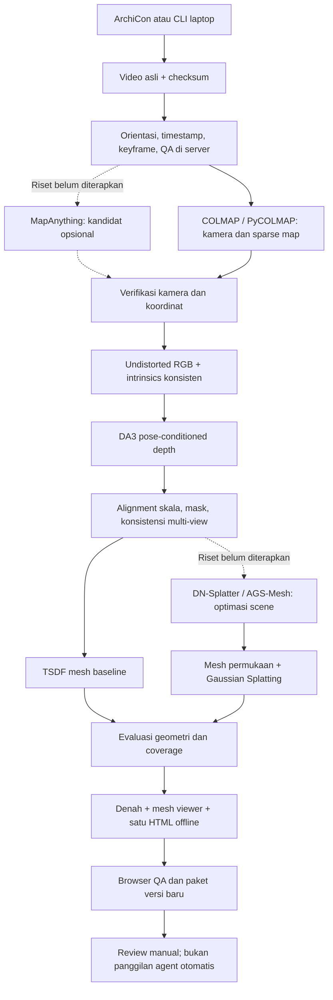

# PRD — ArchiCon: Video ke Mesh, Denah dan Room Tour

**Status:** v1.1 — pipeline E2E dan dashboard ArchiCon tersedia, review tetap manual. Full fresh terbaru acuan: 283/302 frame, 19 gap; arsip baseline dengan entrance terpisah: 286/302 frame, 16 gap. Interior lengkap dan ukuran nyata belum tervalidasi. 
**Diperbarui:** 16 Oktober 2026; audit awal hardware/video pada 14 Oktober 2026. 
**Workspace lokal:** `/absolute/path/to/ArchiCon`. 
**Input utama:** `raw_videos/lantai2_B_part3.MOV`. 
**Target produk aktif:** input video → mesh detail, denah draft dengan kalibrasi, dan room tour satu HTML offline. Gaussian Splatting/MapAnything merupakan riset lanjutan, bukan syarat jalur saat ini.

**Rencana pelaksanaan:** [ROADMAP.md](ROADMAP.md).

**Stack aktual:** [TECHSTACK.md](TECHSTACK.md). **Operasional:** [ARCHICON.md](ARCHICON.md), [WORKFLOW](../WORKFLOW.md). Pengguna melaporkan rekaman baru selesai, overall OK; keputusan review formal tetap pending. Eksperimen closed dipisahkan sebagai [arsip dingin](OUTPUTS_ARCHIVE.md) tanpa penghapusan; produk final dipertahankan. Bagian 2 menyimpan audit/eksperimen bertanggal; angka resource di sana bukan status live.

## 1. Masalah dan tujuan

Eksperimen sebelumnya sudah menghasilkan point cloud berwarna dan viewer. Tahap berikutnya harus memperbaiki konsistensi posisi kamera, bentuk permukaan, dan kualitas visual. Menambah jumlah titik atau menjalankan dua model secara berurutan tidak cukup untuk membuktikan perbaikan.

Tujuan MVP:

1. Memproses video ruangan dengan jejak input, konfigurasi, model, dan hasil yang dapat ditelusuri; `lantai2_B_part3.MOV` adalah video acuan pengujian, bukan input wajib.
2. Menghasilkan mesh permukaan dari area statis yang teramati.
3. Menghasilkan denah SVG/PNG dan room tour mesh dalam satu HTML offline, dengan unit relatif sebelum kalibrasi nyata.
4. Menyediakan dashboard input/progress/output dan handoff review manual; refinement hanya dari keputusan berbukti.
5. Menunjukkan area yang kurang teramati atau tidak andal, termasuk kaca dan objek bergerak.

MVP mencakup area yang teramati dalam input, bukan klaim seluruh lantai berhasil direkonstruksi. Bagian tersembunyi di belakang furnitur atau tidak pernah direkam tidak dianggap selesai. Optimized Gaussian Splatting tetap kandidat riset setelah pipeline mesh dan capture memenuhi kebutuhan.

## 2. Fakta yang sudah diperiksa

### 2.1 Input video

Hasil pemeriksaan lokal dengan `ffprobe` dan SHA-256:

| Properti | Hasil |
|---|---|
| Durasi | 150,840 detik |
| Ukuran file | 444.210.009 byte, sekitar 423,6 MiB |
| Video | H.264, `yuv420p` |
| Resolusi encoded | 1920 × 1080 |
| Rotasi display matrix | −90° |
| Orientasi tampil | Portrait; normalisasi orientasi menghasilkan 1080 × 1920 |
| Frame rate | Sekitar 60 fps; nominal `60000/1001`, rata-rata `25125/419` |
| Warna | BT.709 untuk primaries, transfer, dan color space |
| Audio | AAC; tidak digunakan untuk rekonstruksi |
| SHA-256 | `2247b1b154b1f26dd4f85e90ca3a5d8afb28a73bf76348964448c1b44cff1955` |

File server pada `/srv/archicon-legacy/data/raw_videos/lantai2_B_part3.MOV` memiliki ukuran dan SHA-256 yang sama. Transfer ulang video belum diperlukan.

Inspeksi contact sheet 12 sampel memperlihatkan kantor, lorong, pantry/area furnitur, partisi kaca, jendela terang, orang, dinding polos, dan tangga menjelang akhir. Ini inspeksi visual awal, belum audit blur, exposure, atau kelengkapan setiap frame.

Perangkat dan penggunaan lensa iPhone 13 mini 0,5× berasal dari keterangan pengguna. Identitas lensa pada file ini belum dibuktikan dari metadata. Resolusi aktual file ini 1080p, sehingga pipeline tidak boleh menganggap inputnya 4K.

### 2.2 Server

`server-info.txt` berisi informasi koneksi, bukan inventaris spesifikasi. Spesifikasi berikut diperiksa langsung melalui SSH secara read-only pada **2026-10-14 02:31 UTC**. Angka ketersediaan adalah snapshot, bukan reservasi.

| Komponen | Hasil audit |
|---|---|
| Host | `configured-gpu-host`, akses `gpu-server` |
| OS | Linux x86_64, kernel `6.17.0-29-generic`, glibc 2.39 |
| CPU | Intel Core Ultra 7 265, 20 logical CPU |
| RAM total | Sekitar 62,2 GiB |
| RAM available | Sekitar 10,0 GiB saat audit |
| Disk pada filesystem home | Sekitar 915 GiB total, 240 GiB free |
| GPU fisik 0 | RTX 5080, 16.303 MiB total, 15.839 MiB free, utilization 0% |
| UUID GPU 0 | Disimpan pada profil mesin privat |
| GPU fisik 1 | RTX 5080, 15.556 MiB terpakai, 284 MiB free; dipakai proses lain |
| Driver NVIDIA | `580.159.03` |
| FFmpeg / FFprobe | Tersedia pada `/usr/bin` |
| COLMAP executable | Tidak ditemukan di PATH |
| PyCOLMAP lama | `4.2.1`, `has_cuda=False` |
| CUDA compiler sistem | `/usr/bin/nvcc`, CUDA **12.0.140** |

Environment lama `/srv/archicon-legacy/.venv`:

| Package | Versi / status |
|---|---|
| PyTorch | `2.11.0+cu130`, runtime CUDA 13.0, compiled architecture mencakup `sm_120` |
| torchvision | `0.26.0` |
| xformers | `0.0.35` |
| NumPy | `1.26.4` |
| OpenCV | `4.11.0.86` |
| Open3D | `0.20.0` |
| trimesh | `5.1.1` |
| depth-anything-3 | Installed editable package, version metadata `0.0.0` |
| gsplat / Nerfstudio / DN-Splatter | Tidak terpasang di environment yang diperiksa |

**Implikasi:** inference DA3 memiliki environment lama yang bisa diperiksa dan direproduksi. Build extension Gaussian Splatting belum siap dibuktikan: compiler sistem CUDA 12.0 tidak mendukung target Blackwell `sm_120`, walaupun wheel PyTorch sudah mendukungnya. Environment/SDK baru harus disiapkan tanpa mengubah instalasi sistem atau environment lama.

### 2.3 Cache model yang tersedia

Cache server: `/srv/model-cache/huggingface/hub`.

| Cache / model | Revision snapshot | Bobot yang ditemukan |
|---|---|---|
| `depth-anything/DA3-LARGE` | `c54c26b16ec04d218e8d584ecf4bce082a9fcc20` | `model.safetensors`, 1.643.843.860 byte |
| `depth-anything/DA3METRIC-LARGE` | `4010e39f3634a45bc60553321fb49fb760bd594e` | `model.safetensors`, 1.336.734.448 byte |
| `depth-anything/DA3NESTED-GIANT-LARGE-1.1` | `b2359bdf726fb44ef62acca04d629dcf158053e7` | `model.safetensors`, 6.759.558.100 byte |
| `depth-anything/da3-base` | `f4a6c9b3c95e41c82048423d3493a81ec3fa810e` | `model.safetensors`, 541.518.028 byte |

Pada audit awal hanya keberadaan file dan ukuran yang diperiksa. DA3-LARGE kemudian lolos smoke empat view (§2.6); tiga checkpoint lain belum dimuat ulang. Snapshot cache dipakai secara read-only. DA3-LARGE lama dipertahankan sebagai baseline, bukan otomatis dianggap checkpoint terbaik untuk eksperimen baru. Cache MapAnything dan DSINE tidak ditemukan pada pencarian model di lokasi ini; lokasi lain belum diaudit.

### 2.4 Proyek dan baseline lama

- Lokal: `/absolute/path/to/archicon-legacy`.
- Server: `/srv/archicon-legacy`.
- Git HEAD proyek server: `d662e6fda947d0ebf4721067e7d6515e68bf8a23`.
- Checkout server memiliki perubahan tracked dan untracked. HEAD saja tidak merepresentasikan source yang dipakai eksperimen terakhir.
- Checkout DA3: `Depth-Anything-3`, HEAD `3d835ec1a5802d64a8b8b15f817a1ab54809bfe4`, dengan patch lokal loop detector dan file tambahan.
- Runner nyata berada di `scripts/run_poc.py` dan `scripts/run_streaming.py`. `src/vision/depth_estimator.py` masih menyediakan mock depth; smoke test sintetis tidak membuktikan inference model nyata.
- Runner lama menetapkan GPU fisik 0 di source. Proyek baru harus menerima pilihan GPU dari konfigurasi/environment.

Baseline untuk video identik sudah ada:

| Artefak | Fakta yang diperiksa |
|---|---|
| `outputs/stream_l2bp3/results_output/frame_*.npz` | 429 file, total sekitar 491 MiB |
| Isi contoh frame | RGB `504 × 280 × 3`, depth dan confidence `504 × 280`, intrinsics `3 × 3` |
| `outputs/stream_l2bp3/camera_poses.txt` | 429 pose, masing-masing 16 angka |
| `outputs/stream_l2bp3/streaming_config.yaml` | Chunk 60, overlap 30, `loop_enable: false` |
| `outputs/stream_l2bp3/streaming.log` | 14 chunk dan 13 alignment antar-chunk |
| `outputs/da3_l2bp3/scene.glb` | 31.543.636 byte; representasi visual lama, belum dibuktikan sebagai mesh permukaan |
| `outputs/web/l2bp3/scene.ply` | Point cloud viewer lama, 1.971.419 titik menurut `scene.json` |
| `outputs/web/l2bp3/scene.json` | `units: m`, `scale_uncertainty: 0.1397` |

Nilai `scale_uncertainty` 13,97% adalah metadata estimator lama, bukan hasil validasi error ukuran terhadap pengukuran lapangan. Error alignment pada streaming log juga tidak boleh langsung diberi satuan meter sebelum konvensi skala diverifikasi. Pemetaan 429 frame ke timestamp video perlu dipulihkan sebelum baseline digunakan dalam evaluasi numerik.

Workspace part2 belum memiliki Git repository saat audit awal. Struktur lokal/server, Git pada branch `setup/project-structure`, dan environment Python 3.12 terpisah kini tersedia. Video server, cache model, serta baseline lama direferensikan melalui symlink. Dependency CPU audit/PyCOLMAP4.2.1 sudah diuji. Runtime inference disalin ke `.venv-inference` dengan source DA3 vendor terpisah; package sistem/user masih diwarisi. Tidak ada checkpoint baru yang diunduh.

### 2.5 Bukti implementasi awal

- Preflight menyimpan inventory, source/dirty file hashes proyek lama dan DA3, resource gate, serta validasi file empat snapshot cache. Hasil resource pass tidak berarti inference siap.
- Audit `l2bp3_audit_local_002`: 9.045 decoded frame, 302 keyframe portrait 1080 × 1920, split temporal tetap 242 train/60 validation. Sebanyak 34 frame berskor sharpness relatif rendah tetap disimpan untuk continuity. PTS aktual dan hash setiap JPEG tercatat; gap keyframe maksimum 0,968334 detik.
- Pilot 15–45 detik dipertahankan setelah review lima contact sheet: 52 train dan 8 validation. Area dinding rendah tekstur, belokan, orang, serta kaca diberi catatan; semantic masks belum dibuat.
- Import `legacy_l2bp3_001` memetakan 429 cache frame ke JPEG dan timestamp filename. Sembilan spot check citra berkorelasi >0,999 dengan video sumber. Timestamp legacy tetap perkiraan, bukan decoder PTS terverifikasi; raw depth/translation relatif dan baseline hanya pembanding visual.
- Pilot kamera CPU `l2bp3_camera_pilot_002` meregistrasi 52/52 train frame pada model utama, 3.658 sparse points, median residual 0,721 px dan P95 2,487 px pada resolusi asli. Dua model kandidat dilaporkan; hanya model terbesar diteruskan. OPENCV intrinsics dioptimasi, lalu RGB di-undistort ke PINHOLE 1078 × 1927 dengan K baru.
- Validation RGB tidak dipakai membangun map; localization dan perbandingan kalibrasi ditambahkan pada §2.6. Kamera tetap berskala arbitrer dan belum dibandingkan dengan ukuran lapangan. Gate reprojection hanya bukti konsistensi korespondensi, bukan bukti akurasi dimensi ruangan.

Run memakai ID unik dan status eksplisit; tahap kamera menolak audit upstream yang belum selesai. Laporan hasil dan langkah berikutnya dirangkum di [PROGRESS.md](PROGRESS.md).

### 2.6 Validation kamera dan smoke DA3

- SIMPLE_RADIAL juga meregistrasi52/52 train frame, median/P95 native0,775/2,574px; OPENCV0,721/2,487px. Kedua model memakai track/inlier berbeda sehingga selisih bukan perbandingan pada ground truth identik.
- Delapan validation view dilokalisasi dengan fixed-map/fixed-K PnP. OPENCV terbaru `l2bp3_validation_opencv_002`:8/8,1.530inliers,median/P950,965/3,270px. SIMPLE_RADIAL:8/8,1.537inliers,0,964/3,315px. Source map/database hashes tetap identik; tidak ada BA atau optimasi scene memakai validation RGB.
- OPENCV dipertahankan sementara. Perbandingan lintasan setelah alignment berbasis orientation masih berbeda rotation P957,45°; ini membatasi klaim kalibrasi/drift. Stabilization/crop dan akurasi fisik belum diverifikasi.
- `l2bp3_da3_smoke_001` memuat DA3-LARGE snapshot lokal dan menjalankan empat train view20–26detik pada RTX5080GPU0. Output4×504×280, seluruh depth finite/positif, NPZ float32Z/conf dan RGB/K/w2c tersimpan. Model/source/weightsSHA256 dicatat; tidak ada fusion atau training scene.
- Peak terukur: PyTorch allocated2,665GiB,reserved3,561GiB; host ru_maxrss3,854GiB; GPU process sample3,875GiB. Supervisor selesai exit0 tanpa abort; angka ini tidak membuktikan window 16/fulltake akan muat.
- DA3 API menyelaraskan trajectory scale lalu mengganti output E/K dengan conditioning. Raw predicted E/K dan scale0,2773489702 disimpan sebelum overwrite. Output depth tetap dalam unit COLMAP relatif, bukan meter. Median disagreement terhadap sparse training Z3,0–10,7% perview adalah diagnostik internal, bukan error ukur ruangan.

### 2.7 Pilot52frame dan permukaan TSDF

Empat window 16 dengan overlap4 memproses seluruh52 frame training. Raw64 prediksi dan
52 output pilihan tetap dalam world kamera global. Agreement overlap98,5–99,8% pada
toleransi 10% adalah diagnostik internal, bukan akurasi terhadap pengukuran.
Masks glazing dan person bbox ditinjau manual; model kecil hanya menemukan 1 orang,
sehingga52 bbox manual ditambahkan. Mask tetap incomplete. Filtering spatial lalu
occlusion-aware multi-view mempertahankan mean 85,38%pixel dari grid asli, dibanding
87,09% base. Normals unit camera-facing tersimpan perframe.

TSDF CPU menghasilkan spatialbaseline 3.997.957 triangle dan filtered 3.767.043 triangle,
dengan parameter bersama voxel 0,015977/sdf-trunc 0,063908/depth-trunc 8,89644 dalam
unit scene relatif. Open3D 0.19.0 dipakai pada environment geometry terpisah setelah
fixture menemukan regresi 0.20. EksporcoloredPLY danGLB diverifikasi hash,faces,
positions,bounds,colors. Mesh filtered masih open,12.519 components,250.095boundary-or-
nonmanifold edges,vertex-manifold false. Belum cocok untuk collision atau dimensi
terverifikasi. Vertex RGB 280×504 bukan texture atlas detail. Lihat PROGRESS untuk preview.

### 2.8 Audit lubang dan variasi fusion

Render seluruh triangle pada delapan query kamera tetap membuktikan lubang kecil
pada dinding ada di geometri. Preview lama hanya sampled vertices. Double-sided
material memperbaiki tampilan dari luar; dari dalam koridor hanya menambah mean
coverage sekitar 0,052 percentage point, sehingga bukan solusi lubang geometri.

Lima variasi memakai depth52 TRAIN yang sama, tanpa inference ulang. Kandidat
sementara `voxel1p5_trunc8` memakai voxel0,0239656/sdf-trunc0,191725/depth-trunc8,89644
dalam unit relatif. Mean ray-hit coverage delapan view naik89,85%→91,16%; crop
dinding kiri98,98%→100%. Ini visibility crop, bukan dinding seluruh ruang selesai.
RGB MAE pada common-hit pixels sedikit memburuk15,787→15,975/255. Permukaan lebih
bersih dengan1.407.316triangle; area kosong besar, blur warna dan risiko bridging
dari truncation lebih lebar masih ada. Belum ada depth ground truth.

Alternatif confidenceq0 pada voxel2×/trunc4 memberi coverage96,25%, tetapi
fragmentasi meningkat dibanding q10 pada parameter identik. Simpan untuk review,
belum dipilih sebagai geometri utama. Semua hasil lama dipertahankan; GLB review
hanya menambah rigid scene-root transform dan double-sided material, binary
geometry tetap identik. Delapan query kini dipakai memilih konfigurasi development;
evaluasi akhir memerlukan view yang belum dipakai memilih konfigurasi.

Laporan perbandingan (`../outputs/archive/experiments_2026-10-16/flat/l2bp3_fusion_review_001/review.md`, lokal) ·
GLB kandidat (`../outputs/archive/experiments_2026-10-16/flat/l2bp3_fusion_review_001/room-pilot-improved.glb`, lokal).

### 2.9 Pemrosesan seluruh video

Prioritas pengguna kini seluruh area yang terlihat dalam video, dengan toleransi
lubang ringan. Seluruh302keyframe0,0167–150,8233detik dicoba untuk kamera. Peta utama
memiliki283frame, ditambah3frame area masuk pada world lokal terpisah. Enam belas
frame tanpa pose andal tetap ditampilkan dalam video review dan dilaporkan;
tidak ada bagian timeline yang dihapus diam-diam.

Seluruh283depth utama dan3depth area masuk diproses. Kamera ekstrem pada59,85detik
dipulihkan lewat fixed-mapPnP184inliers (median1,347/P953,391px), tanpa mengubah
kalibrasi/map asli. Depth/fusion/render dihitung ulang pada run baru. Percobaan
high-resolution sequentialSfM tidak memulihkan gap dan memecah peta; tidak dipilih.

Mesh utama hasil koreksi3.964.088triangle; strict comparison3.530.113triangle.
Coverage mode mempertahankan observed depth tanpa contradiction, termasuk bagian
tanpa support yang ditandai uncertain. Bukan hole fill. Full-scene voxel ditetapkan
median-depth/80, truncation8voxel dalam unit relatif. Dynamic masks dan kaca tetap
incomplete. GLB utama dan area masuk tidak digabung tanpa bukti transform.

Semua area timeline memiliki view terproses, tetapi bukan bukti semua interior
ruang lengkap. Rekaman tambahan prioritas:0–7detik untuk sambungan area masuk,
120–143detik dengan masuk ke ruang berkaca, dan148,79–150,84detik untuk tangga.
Video review menampilkan302observasi, termasuk16gap; constant2fps menghasilkan
presentasi151detik dengan timestampPTS asli ditulis pada tiap frame.

Paket seluruh video (`../outputs/archive/experiments_2026-10-16/flat/l2bp3_full_delivery_001/report.json`, lokal) ·
GLB utama (`../outputs/archive/experiments_2026-10-16/flat/l2bp3_full_delivery_001/room-full.glb`, lokal) ·
Video review (`../outputs/archive/experiments_2026-10-16/flat/l2bp3_full_delivery_001/full-video-review.mp4`, lokal).

## 3. Pilihan pendekatan dan keputusan

### Status implementasi 16 Oktober 2026

Entrypoint `scripts/run_pipeline.py` menjalankan video → audit → kamera → DA3 → filtering/TSDF → render/denah → HTML → browser QA → review manual. Dashboard ArchiCon membungkus alur yang sama melalui backend localhost. Job baru berada di `outputs/jobs/<job_id>/`; produk di `end_product/<job_id>/vNNN/`. Hasil lama/PART1 dipertahankan.

Cold-run `part2_full_001` menyelesaikan 18 stage dan 280/302 frame dengan lima world. Matcher auto/exhaustive `part2_full_002` memakai ulang hanya audit fresh yang terverifikasi, lalu menghitung kamera/depth/geometri baru: 283/302 pada satu world utama, review `needs_capture`. Arsip 286/302 dengan entrance-local terpisah tetap tersedia. Smoke nested fresh `layout_smoke_001` selesai 60/60; uji HTTP `archicon_cache_001` hanya packaging cache video acuan, bukan bukti video baru.

Regresi dashboard tercatat: 246 tes lokal (242 lulus, 4 dilewati), 74 tes server; QA desktop/mobile, upload, recovery koneksi dan ZIP lulus. Bukti dan detail: [PROGRESS](PROGRESS.md), verifikasi ArchiCon (`../outputs/dashboard_qa/verification.json`, lokal). Hasil ini tidak membuktikan seluruh interior atau dimensi meter.

| Pendekatan | Kegunaan | Keterbatasan |
|---|---|---|
| A. DA3 streaming / Nested feed-forward | Baseline cepat, reuse cache dan output lama | Drift, alignment antar-chunk, dan skala prediksi belum menjamin permukaan detail |
| B. Kamera terverifikasi + DA3 depth + TSDF | **Jalur utama yang tersedia**; geometri dan rendering dievaluasi terpisah | Mask/capture masih dapat tidak lengkap; optimasi splat bukan bagian pipeline ini |
| C. MapAnything sebagai initializer / depth-conditioned model | Eksperimen perbaikan kamera atau geometri | Model tambahan tidak menjamin kualitas; membutuhkan penyesuaian koordinat dan skala |

Keputusan awal: bangun baseline A dari artefak yang tersedia, lalu jalur B. Uji C setelah evaluasi B dapat diulang. Jika pose COLMAP gagal pada zona tertentu, kandidat MapAnything dapat diuji lebih awal pada zona tersebut; kegagalan tidak disembunyikan dengan memaksa penggabungan peta.

Tidak ada kewajiban membeli kamera 360. Akuisisi tambahan menggunakan iPhone yang sama dapat dilakukan bila audit coverage menunjukkan area penting belum teramati.

## 4. Pengguna dan alur penggunaan

Pengguna utama adalah operator teknis yang menjalankan rekonstruksi di server dan reviewer yang menilai environment lewat browser atau Blender.

1. Operator memilih/upload video dan ID job baru melalui ArchiCon atau CLI; profil mesin menentukan satu GPU yang diizinkan.
2. Preflight memeriksa input, resource, dependency, dan model lokal.
3. Operator memantau stage, log, contact sheet/render setelah tersedia, serta coverage; anotasi kaca/area dinamis dapat direview manual.
4. Pipeline menyimpan attempt numerik, lalu menulis mesh, denah, HTML, kalibrasi draft dan laporan pada paket versi baru; tidak menghasilkan splat pada jalur ini.
5. Reviewer membandingkan baseline dan kandidat dari viewpoint yang sama.
6. Bila kualitas atau coverage gagal, laporan menunjukkan zona dan alasan untuk pemrosesan ulang atau rekam tambahan.

## 5. Arsitektur produk aktif dan cabang riset

MapAnything adalah cabang kandidat, bukan tambahan wajib pada semua run. Memakai model sebagai initializer lalu menjalankan bundle adjustment membutuhkan korespondensi gambar yang benar; bukan sekadar memuat pose hasil model ke optimizer.

## 6. Kontrak data

### 6.1 Video dan frame

- Original video immutable; normalisasi orientasi dilakukan satu kali saat decoding.
- Setiap frame menyimpan ID stabil, timestamp presentasi, source-video hash, ukuran encoded/display, transform orientasi, sharpness, dan alasan diterima/ditolak.
- Timestamp mengikuti decoder/PTS; tidak hanya `frame_index / nominal_fps`.
- Seleksi keyframe mempertahankan coverage temporal dan baseline translasi. Area kosong tidak ditolak hanya karena skor teksturnya rendah.
- Mask `valid`, `dynamic`, dan `reflective/uncertain` dipisahkan. Area tidak diketahui bukan depth nol yang dianggap permukaan.

### 6.2 Kamera dan depth

- Kontrak internal menggunakan camera-to-world `c2w` 4×4, konvensi kamera OpenCV: X kanan, Y bawah, Z maju.
- World frame awal berasal dari solusi kamera. Transform display Y-up disimpan terpisah dan diterapkan konsisten pada kamera/mesh viewer; world rekonstruksi asli tetap dipertahankan.
- Adapter DA3 memakai extrinsics `w2c` dan intrinsics undistorted dari kontrak kamera `c2w`; hasil alignment/raw predicted E/K dicatat. Adapter MapAnything belum diimplementasikan.
- Intrinsics selalu dikaitkan dengan ukuran dan transform gambar yang tepat. Resize/crop/undistortion mengubah intrinsics yang disimpan.
- Depth kanonik adalah Z-depth kamera, bukan jarak sepanjang ray. Konversi, unit, invalid mask, dan scale factor dicatat eksplisit.
- Skala memiliki status `relative`, `learned_metric`, atau `externally_calibrated`. Skala COLMAP arbitrer tidak otomatis menjadi meter setelah conditioning DA3.
- Confidence tiap model dipertahankan dengan definisi asalnya; tidak dirata-ratakan lintas model seolah sudah terkalibrasi.
- Bentuk, finiteness, invertibility, reprojection, dan kesesuaian ID diperiksa sebelum fusion.

### 6.3 Provenance dan output

- Setiap stage mencatat input hash, config hash, model ID/revision, source revision beserta dirty-state snapshot, precision, resolusi, seed, waktu, dan peak RAM/VRAM.
- Raw predictions dan hasil filtering disimpan terpisah.
- Output mesh menyatakan jumlah vertex dan face. GLB yang hanya berisi point primitives tidak diberi label mesh.
- Splat PLY dan point-cloud PLY dibedakan melalui metadata dan format atributnya.
- Run gagal memiliki status/reason yang eksplisit; file parsial tidak dipromosikan sebagai output final.

## 7. Kebutuhan fungsional

| ID | Kebutuhan dan bukti penerimaan |
|---|---|
| FR-01 | Ingestion memvalidasi checksum, durasi input dan rotasi. Manifest mencakup timeline video terpilih serta rentang yang ditolak; 150,84 detik hanya untuk video acuan. |
| FR-02 | QA menampilkan contact sheet, sharpness/exposure, temporal gaps dan status anotasi area dinamis/kaca. Rentang pilot 15–45/stress 110–140 detik adalah eksperimen acuan, bukan konstanta semua job. |
| FR-03 | Rekonstruksi kamera menghasilkan connected components, registration rate, residual reprojection, dan trajectory. Pilihan camera model dibuktikan dengan residual, bukan FOV default 85°. |
| FR-04 | DA3 dapat menerima kamera yang sudah diverifikasi. Prediksi tersimpan per frame/window agar seluruh video tidak harus berada di RAM/VRAM sekaligus. |
| FR-05 | Alignment skala dan filtering memisahkan outlier, occlusion, dan area tanpa dukungan. Coverage sebelum/sesudah filtering ikut dilaporkan. |
| FR-06 | TSDF menghasilkan triangle mesh dengan provenance, laporan filtering dan unit scene. Optimized mesh/splat adalah eksperimen terpisah. |
| FR-07 | Viewer mesh/kamera memakai transform display yang sama; mendukung orbit, viewpoint tersimpan, camera path dan penandaan gap. Komponen tanpa transform terverifikasi tetap terpisah. |
| FR-08 | Evaluasi baseline/kandidat menggunakan frame, mask, resolusi, dan viewpoint yang disamakan. Jumlah titik bukan metrik utama kualitas. |
| FR-09 | Pipeline dapat melanjutkan dari stage valid tanpa menimpa eksperimen lama atau mengunduh ulang checkpoint yang sudah tersedia. |
| FR-10 | Jika riset MapAnything dijalankan, wajib hasil A/B dan keputusan tertulis; belum menjadi acceptance pipeline produk aktif. |
| FR-11 | Denah draft SVG/PNG dari irisan horizontal geometri aktual; tampilkan bukti irisan, kandidat garis dan lintasan tanpa mengarang batas ruangan tertutup. Bentang mesh tidak diberi label ukuran kamar. |
| FR-12 | Tour satu HTML offline berisi mesh, orbit/potongan atap, seluruh viewpoint valid dan playback yang berhenti pada gap >2detik. Komponen yang belum aligned tetap terpisah. |
| FR-13 | Pengukuran denah memakai unit relatif sampai pengguna memilih segmen dan memasukkan jarak nyata. Kalibrasi independen per-komponen, meter selalu perkiraan dan belum tervalidasi; unduh SVG menyimpan skala draft dan segmen pilihan. |
| FR-14 | ArchiCon menyediakan input/upload streaming, ID unik, progress nyata, history, resume dan unduhan produk/ZIP; satu controller dashboard aktif, UI desktop/mobile. |
| FR-15 | Pipeline berhenti untuk review manual tanpa layanan agent/LLM; JSON keputusan tervalidasi membuat versi baru atau refinement preset terbatas. |

Normal tambahan dari model seperti DSINE bersifat opsional; baseline normal dapat diturunkan dari depth yang valid. Tidak ada klaim output DA3 otomatis menjadi input siap pakai DN-Splatter tanpa adapter.

Prioritas pengguna14Oktober2026 adalah FR-11–13; belum ada jarak acuan nyata.
Implementasi memakai display Y-up yang sama dengan GLB delivery, estimasi arah atas
dan lantai, serta tiga irisan pada0,8/1,2/1,55×tinggi kamera median di atas lantai.
Garis kandidat harus didukung sedikitnya dua irisan; belum semantik dinding/kamar.
Mesh HTML adalah turunan ringan; file detail asli immutable. Kalibrasi browser
hanya memengaruhi label ukuran dan metadata SVG, bukan koordinat GLB sumber.
Entrypoint video→output tersedia melalui `scripts/run_pipeline.py`, dengan exporter
dan builder sebagai stage internal. ArchiCon memanggil controller yang sama.

## 8. Resource dan operasional

### 8.1 Kebijakan resource awal

- Hanya satu GPU fisik yang dipilih. Saat audit GPU 0 tersedia; cek ulang setiap run. UUID dapat dipakai untuk menghindari ambiguitas index.
- Setelah `CUDA_VISIBLE_DEVICES` membatasi satu GPU, device di proses adalah logical `cuda:0`; jangan menganggap angka itu selalu GPU fisik 0.
- Preflight: GPU free minimal 14 GiB, host MemAvailable minimal 8 GiB, disk free minimal 50 GiB. Jika gagal, status waiting_resources dan resume setelah tersedia; tidak melonggarkan threshold otomatis atau mengganggu proses lain.
- Target awal peak VRAM proses maksimal 14 GiB, dengan peak PyTorch allocated sekitar 12 GiB. Ukur keduanya karena extension/native allocator tidak selalu tercatat PyTorch.
- Target peak host RSS pipeline 6 GiB pada kondisi server sekarang. Gunakan float32, file per frame, dan bounded cache; jangan menumpuk semua frame/depth dalam float64.
- Awali 4 CPU thread dan maksimal 2 worker. Naikkan hanya setelah profil resource menunjukkan cukup headroom.
- Model dijalankan bergantian; unload setelah stage selesai. Resolusi tinggi dan penambahan view dilakukan setelah pilot lolos.
- Resource guard memeriksa disk free; tidak ada limit storage 25 GiB/job yang ditegakkan. Retensi/penghapusan bukan otomatis dan hasil lama tidak ditimpa.

Threshold ini adalah konfigurasi guard saat ini, bukan jaminan akurasi, waktu selesai atau peak memori setiap rekaman.

### 8.2 Isolasi

- Proyek lama, environment lama, checkpoint cache, dan input asli tetap menjadi sumber read-only.
- Workspace server baru: `/srv/archicon`; sudah dibuat dengan environment Python 3.12 dasar yang independen dari proyek lama.
- Environment inference dan environment geometry/splatting dipisahkan bila dependensinya tidak kompatibel. Pertukaran memakai kontrak file.
- Tidak menjalankan `scripts/setup_server.sh` lama: script tersebut mencoba wheel CUDA 12.4 dan mengubah environment lama.
- Akses shell dari workstation memakai RTK. RTK belum terpasang di server; pemeriksaan remote sebelumnya dijalankan melalui `rtk proxy ssh` dari workstation.
- Kredensial di `server-info.txt` tidak disalin ke dokumentasi, log, config, atau repository. Konfigurasi koneksi cukup memakai SSH/key yang sudah bekerja.

## 9. Evaluasi dan acceptance gates

Angka berikut adalah acceptance/target kualitas, bukan klaim semua gate sudah lulus. Resource, kamera/depth/mesh, full-video processing, HTML dan dashboard memiliki bukti regresi; interior lengkap, metrik NVS held-out dan akurasi dimensi eksternal belum terbukti.

| Gate | Kriteria |
|---|---|
| G0 — Resource/build | Satu GPU terisolasi, preflight lolos, inference DA3 nyata. Kernel splatting merupakan gate terpisah jika riset splat diaktifkan, bukan prasyarat pipeline TSDF. |
| G1 — Data | Checksum cocok, orientasi portrait benar, timestamp monoton, seluruh durasi terwakili dalam manifest atau tercatat sebagai gap. |
| G2 — Kamera | Target registration ≥90% pada pilot dan ≥85% pada full take; target median reprojection ≤1,5 px dan P95 ≤4 px pada resolusi matching yang dicatat. Zona tidak tersambung dilaporkan terpisah. |
| G3 — Depth | Proyeksi depth konsisten pada static, non-occluded support yang sama. Perbaikan skor tidak diterima jika dicapai dengan membuang coverage tanpa pelaporan. |
| G4 — Permukaan | Mesh memiliki faces, tidak didominasi NaN/degenerate geometry, dan lulus inspeksi viewpoint tetap pada dinding/pojok/meja/partisi. Tidak wajib watertight pada area tidak teramati. |
| G5 — Visual | Render dari viewpoint validasi dibandingkan pada resolusi dan mask yang sama. Laporkan PSNR/SSIM/LPIPS bila dependensi dan pose validasi tersedia; jangan mengisi metrik yang belum dapat dihitung. |
| G6 — Skala | Tanpa ukuran lapangan atau referensi scanner, hasil tetap `relative`/`learned_metric`. Jika referensi tersedia: satu subset untuk kalibrasi dan minimal 3 jarak independen untuk validasi; target awal median error ≤5%, dilaporkan sebagai lulus/gagal, bukan diasumsikan. |
| G7 — Reproducibility | Artefak memiliki manifest/config/model/source revision dan dapat dibuka ulang tanpa inference ulang. Baseline dan kandidat tidak saling menimpa. |

Pilot evaluasi memakai split 80% train/20% validation berbasis blok temporal; lokalisasi query fixed-map tidak mengoptimasi map memakai query RGB. Produksi full take memakai seluruh keyframe, termasuk original validation, demi coverage. Render produksi karena itu adalah diagnostik internal, bukan evaluasi NVS held-out. Evaluasi akhir membutuhkan view independen yang tidak dipakai memilih atau merekonstruksi scene; metrik tanpa referensi valid ditampilkan unavailable.

Quality report membedakan:

- **Konsistensi internal:** reprojection, depth agreement, trajectory dan residual alignment.
- **Akurasi eksternal:** pengukuran lapangan atau ground-truth scanner, hanya bila tersedia.
- **Kualitas tampilan:** render held-out dan review visual.
- **Coverage:** area teramati/tertolak/tidak diketahui.

Koreksi yaw per frame, pemaksaan dinding 90°, floor snapping, dan carving agresif dari pipeline lama tidak diterapkan sebelum evaluasi raw geometry. Transform global rigid untuk orientasi boleh dilakukan dengan provenance. Beautification tidak boleh dipresentasikan sebagai perbaikan akurasi.

## 10. Scope yang ditunda

- Denah DXF/PDF otomatis, estimasi luas seluruh lantai, dan fitur CAD dari proyek lama.
- Jaminan akurasi survey/engineering atau pengukuran sentimeter tanpa referensi.
- Rekonstruksi sisi objek yang tidak pernah terlihat dan completion generatif.
- Multi-floor, penggabungan banyak take, dan kamera 360/rig.
- Multi-GPU, real-time processing, layanan upload multiuser, autentikasi, dan deployment publik.
- Panorama 360, walk/collision berbasis mesh tervalidasi, dan semantik ruang otomatis. Dashboard ArchiCon dan viewer mesh dasar sudah tersedia.

## 11. Risiko dan tindakan

| Risiko | Tindakan |
|---|---|
| Plain walls, kaca, jendela, orang bergerak | QA, mask, multi-view verification; area gagal ditandai; capture tambahan bila diperlukan |
| Drift take panjang | Kamera diverifikasi; pasangan non-adjacent dan loop candidate diuji geometris; pecah zona bila global map gagal |
| Loop palsu pada lorong berulang | Tidak memakai similarity threshold sebagai satu-satunya bukti; verifikasi feature geometry dan residual sebelum menerima loop |
| CUDA compiler lama | Toolchain user-space/container yang kompatibel dengan Blackwell dan runtime dipilih di environment baru; tidak mengganti sistem global |
| RAM host bersaing | Bounded I/O, float32, resource gate, worker rendah; tidak mematikan proses lain |
| Adapter salah skala/koordinat | Tes reprojection sintetis, depth convention, pose inversion, dan resize intrinsics |
| Dua model mewarisi error yang sama | A/B terhadap baseline serta coverage yang sama; tidak merata-ratakan depth mentah |
| Detail sumber terbatas 1080p/portrait | Optimasi pada RGB resolusi lebih tinggi dari inference bila resource cukup; foto tambahan untuk detail yang kurang |
| Lisensi checkpoint | Fase awal riset internal; catat model/dataset/extension license per run. DA3 Large/Giant/Nested tidak otomatis boleh dipakai komersial. |
| Source lama dirty dan artefak tanpa manifest lengkap | Rekam revision + patch/file hashes; baseline diberi label legacy sampai provenance dipulihkan |

## 12. Urutan keputusan

1. Tunggu laporan uji video baru pengguna; jangan mengasumsikan status atau kualitas hasilnya.
2. Review coverage, source/render, seluruh komponen, denah dan gap setelah hasil tersedia.
3. Terapkan refinement terbatas bila ada bukti masalah filtering/fusion; minta capture tambahan untuk area yang tidak teramati.
4. Ambil ukuran nyata dan validasi jarak independen sebelum menyatakan dimensi akurat.
5. Benchmark detail/resolusi atau recovery kamera generik jika kegagalan membenarkan.
6. Uji MapAnything atau optimized splat sebagai riset terpisah; kernel kompatibel wajib dibuktikan sebelum training splat.

## 13. Referensi

Dokumentasi library diperiksa melalui Context7 dan sumber resmi selama sesi perencanaan. Versi/revision runtime harus tetap dipin saat implementasi.

- [DA3 repository dan model cards](https://github.com/ByteDance-Seed/Depth-Anything-3)
- [DA3 API: kamera, depth, dan Gaussian export](https://github.com/ByteDance-Seed/Depth-Anything-3/blob/main/docs/API.md)
- [DA3-Streaming](https://github.com/ByteDance-Seed/Depth-Anything-3/blob/main/da3_streaming/README.md)
- [MapAnything: input geometri dan ekspor COLMAP](https://github.com/facebookresearch/map-anything)
- [COLMAP tutorial](https://colmap.github.io/tutorial.html)
- [COLMAP camera models](https://colmap.github.io/cameras.html)
- [PyCOLMAP API](https://colmap.github.io/pycolmap/pycolmap.html)
- [DN-Splatter / AGS-Mesh](https://github.com/maturk/dn-splatter)
- [FFmpeg: autorotate dan filters](https://ffmpeg.org/ffmpeg-all.html)
- [NVIDIA Blackwell compatibility guide](https://docs.nvidia.com/cuda/blackwell-compatibility-guide/)
- [MuSHRoom: input iPhone dan mesh referensi untuk benchmark tambahan](https://xuqianren.github.io/publications/MuSHRoom/)

Sumber lokal: README, PRD, ROADMAP, runner, extractor, dan streaming adapter pada proyek `../3d-reconstruction`. Angka eksperimen historis di dokumen lama tidak dianggap hasil benchmark part2 tanpa verifikasi ulang.

Catatan publikasi source19Oktober2026: host/path di atas adalah contoh yang disanitasi, bukan detail akses mesin. Provenance asli tetap pada manifest privat.
