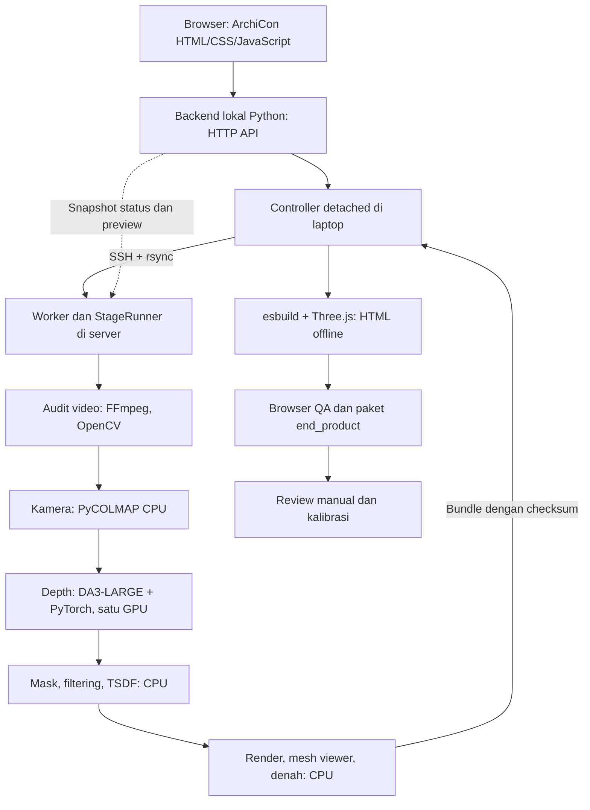

# Tech stack — ArchiCon

**Diperbarui:** 16 Oktober 2026. Dokumen ini menjelaskan stack yang benar-benar dipakai oleh implementasi dan regresi yang telah selesai. Versi di bawah adalah pin proyek atau runtime yang tercatat, bukan klaim versi terbaru upstream. Job rekaman baru dilaporkan selesai, overall OK; review formal tetap pending. Pemeriksaan pengarsipan memvalidasi SHA/packaging, bukan kualitas visual geometri.

## 1. Arsitektur



Dashboard memerlukan backend lokal yang aktif. **Room tour hasil ekspor** adalah satu HTML mandiri yang dapat dibuka tanpa backend atau internet. Keduanya produk berbeda.

## 2. Stack per lapisan

| Lapisan | Teknologi aktual | Peran / sumber implementasi |
|---|---|---|
| Dashboard | HTML, CSS, JavaScript biasa; Fetch/XHR; IBM Plex Sans lokal | Input/upload, history, progress dan hasil; [web/dashboard](../web/dashboard/) |
| Desain dashboard | Adaptasi Carbon Gray100 dari [DESIGN.md](../DESIGN.md) | Dark mode, sudut siku, garis tipis, aksen biru; CSS sendiri, tidak memasang package Carbon |
| Backend web | Python 3.12 stdlib `ThreadingHTTPServer` | HTTP localhost, upload/file streaming, byte range video, ZIP, Host/origin/token; [dashboard_http.py](../src/room_reconstruction/dashboard_http.py), [dashboard_service.py](../src/room_reconstruction/dashboard_service.py) |
| Orchestration | Python 3.12, PyYAML, subprocess, JSON, SHA-256, `fcntl.flock` | Registrasi, controller/worker detached, resume, pengunci, attempt immutable dan provenance; [pipeline_cli.py](../src/room_reconstruction/pipeline_cli.py), [pipeline_state.py](../src/room_reconstruction/pipeline_state.py) |
| Transport | OpenSSH dan rsync | Source allowlist, input video, bundle/artefak terverifikasi; tanpa `--delete` |
| Audit video | FFmpeg/ffprobe, OpenCV, NumPy | Metadata/durasi/PTS/rotasi, sharpness, normalized inter-frame motion, uniform/adaptive keyframe selection dan contact sheet; [ingestion.py](../src/room_reconstruction/ingestion.py) |
| Kamera | PyCOLMAP 4.2.1, CPU SIFT, sequential/exhaustive matching, optional loop closure, incremental SfM/bundle adjustment, undistortion | Pose dan intrinsics per komponen; [reconstruct_full_cameras.py](../scripts/reconstruct_full_cameras.py) |
| Depth | Depth Anything 3 LARGE, PyTorch/CUDA, NumPy float32 | Inference per window dengan kamera terverifikasi; [run_full_depth.py](../scripts/run_full_depth.py), [full_take.py](../src/room_reconstruction/full_take.py) |
| Mask orang | TorchVision SSDLite320 MobileNetV3 Large COCO, CPU | Bounding box orang + anotasi per-frame yang terikat image hash; [build_full_surface.py](../scripts/build_full_surface.py) |
| Filtering | NumPy, OpenCV, modul proyek | Validity/confidence, diskontinuitas depth, mask, occlusion dan multi-view consistency; [filtering.py](../src/room_reconstruction/filtering.py) |
| Mesh | Open3D 0.19.0 CPU `ScalableTSDFVolume`, Trimesh 5.1.1 | Integrasi depth, triangle mesh, PLY/GLB dan transform display; [meshing.py](../src/room_reconstruction/meshing.py) |
| Render QA | Triangle raycasting Open3D, NumPy, Pillow, FFmpeg | Perbandingan source/render, overview dan lintasan; [mesh_audit.py](../src/room_reconstruction/mesh_audit.py), [render_full_surface.py](../scripts/render_full_surface.py) |
| Global architecture | NumPy Umeyama Sim(3), camera validation, deterministic graph, Trimesh GLB | S06G: gabungan world yang terhubung ke root; [alignment.py](../src/room_reconstruction/alignment.py), [global_architecture.py](../src/room_reconstruction/global_architecture.py). Fallback eksplisit; belum global TSDF atau image-only bridge |
| Denah | NumPy irisan horizontal, OpenCV raster/Hough, SVG/PNG | Estimasi lantai, bukti tiga irisan dan kandidat garis; [floorplan.py](../src/room_reconstruction/floorplan.py), [export_room_tour.py](../scripts/export_room_tour.py) |
| Room tour | Three.js 0.186.1, GLTFLoader, OrbitControls, WebGL, HTML/CSS/JS | Workspace arsitektur/interior dark mode, navigasi komponen, roof clipping, recorded viewpoints/playback, denah dan kalibrasi; [web/tour](../web/tour/), [panduan](ROOM_TOUR.md) |
| Packaging web | Node.js, npm, esbuild 0.28.2 | Menanam JavaScript, data, CSS, GLB, bukti denah serta font Plex WOFF2/lisensi OFL ke satu HTML; [web/build.mjs](../web/build.mjs) |
| Verifikasi | Python unittest, tes JS kalibrasi, Playwright CLI 0.1.22 untuk pipeline QA | Kontrak koordinat/resource/artefak, browser offline/desktop/mobile; [tests](../tests/) dan [web/tour/calibration.test.mjs](../web/tour/calibration.test.mjs) |
| Review | Paket JSON + schema + CLI manual | Tidak memanggil agent/LLM otomatis; [pipeline_review.py](../src/room_reconstruction/pipeline_review.py), [schema review](../schemas/agent-review.schema.json) |

Tidak ada database, message broker, frontend framework atau layanan cloud wajib. Status persisten memakai file JSON/JSONL; polling UI sekitar 4 detik dan snapshot worker sekitar 3 detik. Tidak ada WebSocket atau estimasi persentase komputasi buatan. Persentase upload hanya menghitung byte browser → laptop.

## 3. Runtime dan versi

| Environment | Peran | Pin / versi yang tercatat |
|---|---|---|
| Laptop `.venv` | Dashboard, controller, tes dan packaging | Python 3.12; package dasar PyYAML; audit opsional NumPy/OpenCV |
| Server `.venv` | Audit, kamera dan worker | Python 3.12; PyYAML 6.0.3, NumPy 2.5.4, OpenCV headless 4.14.0.94, PyCOLMAP 4.2.1 CPU |
| Server `.venv-inference` | DA3 | PyTorch 2.11.0+cu130, torchvision 0.26.0, xformers 0.0.35, NumPy 1.26.4; source DA3 vendor lokal |
| Server `.venv-geometry` | Mask, filtering, TSDF, render dan ekspor | Runtime terpisah dari audit/inference; NumPy 1.26.4, Open3D 0.19.0, Trimesh 5.1.1; TorchVision untuk detektor CPU |
| Node/npm lokal | Build HTML dan browser QA | Dependency web terikat [package.json](../web/package.json) dan [package-lock.json](../web/package-lock.json) |

Pin langsung: [audit requirements](../environments/audit.requirements.txt), [camera requirements](../environments/camera.requirements.txt), [geometry requirements](../environments/geometry.requirements.txt). Runtime inference/geometry dibuat dari runtime yang tersedia dan masih memiliki ketergantungan package sistem/user; **bukan environment hermetik dengan lock transitive lengkap**. Detail bootstrap dan batas reproduksi: [environments/README.md](../environments/README.md). Pin proyek tidak diperbarui pada pekerjaan dokumentasi ini.

Open3D 0.19 dipertahankan karena fixture TSDF float32 pada eksperimen proyek gagal dengan runtime 0.20 yang diuji. Ini temuan pada runtime tersebut; bukan klaim setiap konfigurasi upstream 0.20 gagal. Runtime CUDA wheel PyTorch berbeda dari compiler CUDA sistem; pipeline mesh saat ini tidak memerlukan build extension Gaussian Splatting.

## 4. Model dan parameter pipeline

- Model aktif: `depth-anything/DA3-LARGE`, revision `c54c26b16ec04d218e8d584ecf4bce082a9fcc20`, bobot lokal `model.safetensors` 1.643.843.860 byte. Registry: [configs/models.yaml](../configs/models.yaml). Source DA3 berasal dari vendor server; run merekam source/API/weights hashes.
- Inference memakai `w2c` dan intrinsics dari kamera undistorted, `align_to_input_ext_scale=True`, `infer_gs=False`, referensi `first`, window maksimal 16 view/stride 12, process resolution 504. Hasil tetap optical-axis Z-depth dalam unit scene relatif; resolusi output mengikuti rasio gambar dan resize model.
- Sampling default memakai base 2 keyframe/detik dan adaptive 4 keyframe/detik pada interval dengan normalized inter-frame motion di atas threshold 0,03. Semua frame tetap berasal dari video asli; frame sintetis tidak dibuat. Kapasitas frame dihitung dari durasi dan high-motion rate; angka 302 khusus video acuan, bukan konstanta untuk semua rekaman.
- Profil room-tour memakai sequential overlap 32. Loop closure bersifat optional dan hanya aman bila `vocab_tree_path` menunjuk ke vocabulary tree lokal; pipeline offline tidak mengunduh asset. Matcher `auto` tetap tersedia: exhaustive untuk ≤400 keyframe aktual, sequential di atasnya. Kesuksesan matching/registrasi tetap bergantung pada rekaman; sampling lebih rapat tidak memulihkan frame yang sudah blur.
- Global alignment memakai minimal enam shared frame-ID dengan fit/validation terpisah, center error maksimal 2% bentang shared trajectory dan error orientasi maksimal 3°. Degeneracy dan cycle conflict ditolak. Transform mesh mengompensasi `world_to_viewer` tiap area; warna asli dipertahankan. Kandidat global tetap relatif dan belum dinyatakan akurat/lengkap.
- Profil CLI opsional [pipeline.dense.yaml](../configs/pipeline.dense.yaml): 4 fps uniform dari frame asli, sequential overlap64, SIFT longest-edge1600/max8192. Uji kamera pada video yang sama menaikkan registrasi 370/502 menjadi 824/999, world diterima 18 menjadi 16, dan porsi world terbesar 15,7% menjadi 28,7% dari frame audit. Ini perbandingan sampling berbeda dan bukan bukti kualitas permukaan atau skala meter; kebutuhan waktu/storage bertambah.
- Default confidence quantile 0,02; voxel length dari median depth/80, SDF truncation 8 voxel. Unit voxel bukan sentimeter sebelum kalibrasi nyata.
- Detektor orang memakai checkpoint lokal SSDLite COCO dengan SHA-256 terikat. Kaca/objek bergerak tidak otomatis termask sempurna; anotasi baru dimulai `unreviewed`.
- Refinement manual dibatasi maksimal 2 ronde × 2 kandidat dengan preset S06/S07 yang dikenal; tidak mengganti kamera atau model secara bebas.

Sumber parameter: [configs/pipeline.yaml](../configs/pipeline.yaml), [pipeline_steps.py](../src/room_reconstruction/pipeline_steps.py), [run_full_depth.py](../scripts/run_full_depth.py). Format input/output kamera wajib mengikuti adapter proyek; dukungan model upstream tidak membuktikan akurasi skala pada rekaman pengguna.

## 5. Device, proses dan resource

Laptop menangani input, transfer, monitoring, HTML build, browser QA dan review. Server menangani komputasi audit/kamera/depth/geometri. Profil: paths.local.yaml (`../configs/paths.local.yaml`, lokal), paths.server.yaml (`../configs/paths.server.yaml`, lokal).

Server yang telah diaudit memiliki dua RTX 5080; pipeline hanya memakai satu UUID GPU yang diizinkan pada profil mesin privat, yang menjadi logical `cuda:0` setelah isolasi. Index fisik dapat berbeda; GPU lain tidak dipilih. Audit/kamera/geometri berjalan pada CPU dengan CUDA disembunyikan.

| Guard saat ini | Batas |
|---|---|
| RAM tersedia sebelum stage | ≥8 GiB |
| Disk server tersedia | ≥50 GiB |
| GPU terpilih sebelum inference | ≥14 GiB free, idle, tanpa compute process lain |
| Process tree host RSS | Target maksimum 6 GiB |
| Memori proses GPU | Target maksimum 14 GiB |
| PyTorch allocator | Cap sekitar 12 GiB |
| CPU / workers | 4 thread / 2 workers |

Ketersediaan RAM/GPU berubah; angka audit lama bukan status live atau reservasi. Resource wait menunggu tindakan/resume, tidak melonggarkan batas diam-diam. Satu controller dashboard aktif memakai kernel lock yang diwariskan ke child; browser/backend dapat ditutup tanpa menghentikan controller/worker. Kontrak lock saat ini memakai `fcntl`, cocok untuk macOS/Linux yang digunakan proyek.

## 6. Penyimpanan dan artefak

```text
raw_videos/<capture>/source.MOV       Input yang disiapkan pengguna
raw_videos/uploads/<upload>/source.*  Upload browser lengkap
outputs/jobs/<job_id>/
  config/                            Konfigurasi per input
  stages/<stage>/<run_id>/            Attempt numerik immutable
  logs/                              Controller, worker dan stage
  qa/                                Browser QA dan preview live
  review/                            Paket dan keputusan review manual
  job.json, job-status.json           Identitas dan status
  stages.json, events.jsonl           Attempt dan kejadian server
  controller-progress.json           Fase controller lokal
  dashboard-snapshot.json            Cache ringkasan server
outputs/.run-index/                  Routing run-ID → path stage
outputs/.dashboard/                  Metadata controller / ZIP temporer
end_product/<job_id>/vNNN/
  mesh/                              Mesh detail GLB
  denah/                             Draft SVG/PNG
  room_tour/index.html               Viewer offline mandiri
  reports/                           Coverage, kegagalan dan review
  calibration.json                   Draft kalibrasi
  manifest.json, README.md            Checksum dan petunjuk
end_product/<job_id>/latest.json     Pointer versi dan status kualitas
```

Artefak diagnostik stage dapat meliputi NPZ float32, kamera JSON/COLMAP, PLY, PNG/JPEG dan MP4. Hanya bundle yang diperlukan yang diambil ke laptop; depth arrays/model weights tidak dikirim ke browser. ZIP unduhan dibangun sementara di disk dan dibuang setelah transfer.

Eksperimen legacy `outputs/<run_id>` serta tiga job uji dipisahkan ke `outputs/archive/experiments_2026-10-16/{flat,jobs}/`; manifest dan registry asli tidak diedit. Restore ke path asal diperlukan sebelum reuse/resume/refinement lama. `end_product/part1`, `end_product/part2` dan produk job baru tetap pada tempatnya. Utilitas `scripts/archive_outputs.py` memakai Python stdlib, SHA-256, kernel lock, atomic no-replace rename macOS/Linux dan journal fsync; tidak memiliki fungsi hapus. [Panduan arsip](OUTPUTS_ARCHIVE.md). `.sync-files` mengatur source/doc; transfer media dan artefak dilakukan terpisah. SHA-256 dan fingerprint memeriksa reuse; cache acuan tidak boleh dipakai sebagai rekonstruksi video lain.

## 7. Stack yang belum dipakai dan batas hasil

MapAnything, DSINE, gsplat, Nerfstudio, DN-Splatter/AGS-Mesh, optimized Gaussian Splatting, tekstur resolusi tinggi, dan semantic architectural floorplan **belum menjadi jalur produk yang tersedia**. Checkpoint metric/nested lain di cache juga belum menjadi default pipeline. Riset ini opsional setelah masalah rekaman/geometri dan manfaatnya dibuktikan.

Denah sekarang berasal dari irisan geometri, sehingga furnitur/partisi dapat ikut terlihat. Room tour menampilkan triangle mesh berwarna vertex, bukan panorama 360 atau scene Gaussian. Capture iPhone biasa didukung; kamera 360 dan LiDAR tidak wajib. Coverage frame tidak menjamin seluruh permukaan ruangan terlihat, mesh watertight, atau ukuran meter akurat. Kalibrasi HTML adalah draft per-komponen dan memerlukan ukuran nyata serta validasi jarak lain.

## 8. Bukti dan navigasi

Regresi tercatat sebelum uji rekaman baru pengguna: 246 tes lokal (242 lulus, 4 dilewati), 74 tes server pipeline/dashboard; QA desktop/mobile, upload, koneksi terputus/pulih dan ZIP lulus. Bukti: verifikasi dashboard (`../outputs/dashboard_qa/verification.json`, lokal). Smoke `layout_smoke_001` fresh 60/60; `archicon_cache_001` menguji packaging HTTP memakai cache video acuan, bukan inference video baru. Angka ini snapshot pengujian, tidak diperbarui dengan asumsi hasil job pengguna.

Regresi pembaruan UI room tour:258tes lokal (254lulus,4dilewati),7tes JS kalibrasi; builder memeriksa font offline dan original data/overwrite protection. QA v002 memeriksa seluruh4komponen,252frame-ID unik, lima ukuran layar, JSON/SVG, playback/gap/lookaround, HTTP/CSP dan ZIP. Mesh/denah serta seluruh embedded data identik dengan v001; tidak menjalankan inference atau review otomatis. Bukti: [ROOM_TOUR](ROOM_TOUR.md).

- [ARCHICON](ARCHICON.md): cara menjalankan dashboard.
- [WORKFLOW](../WORKFLOW.md): E2E, review dan refinement manual.
- [PRD](PRD.md): kebutuhan dan acceptance.
- [ROADMAP](ROADMAP.md): status dan prioritas.
- [PROGRESS](PROGRESS.md): hasil eksperimen bertanggal.

Referensi konsep upstream diperiksa melalui Context7; versi runtime tetap mengikuti bukti proyek: [DA3 API](https://github.com/ByteDance-Seed/Depth-Anything-3/blob/main/docs/API.md), [PyCOLMAP](https://colmap.github.io/pycolmap/), [Open3D RGB-D integration](https://www.open3d.org/docs/release/tutorial/pipelines/rgbd_integration.html), [Three.js GLTFLoader](https://threejs.org/docs/#GLTFLoader). Lisensi checkpoint dan aset dicatat pada registry/artefak masing-masing; kemampuan upstream tidak otomatis diterapkan di proyek ini.
